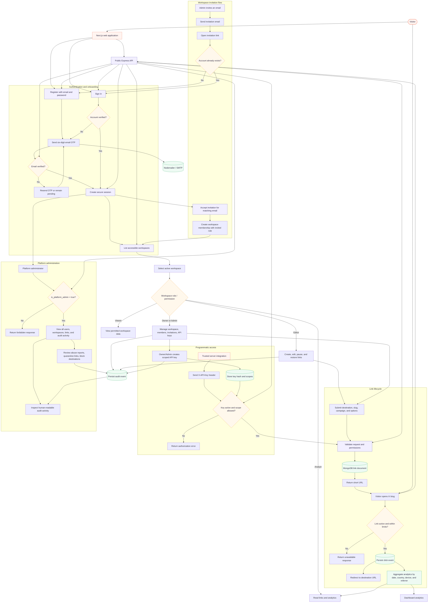

# LinkForge

A full-stack URL-shortener and link-management monorepo built with Next.js,
Express, TypeScript, and MongoDB. Product requirements and technical decisions
are maintained in [`PRD.md`](PRD.md) and [`TRD.md`](TRD.md).

## Current Capabilities

- Email/password registration with six-digit email OTP verification.
- Password recovery, secure cookie sessions, CSRF protection, and session revocation.
- Email-based workspace invitations for existing and new users.
- Multiple workspaces with Owner, Admin, Editor, Analyst, and Viewer roles.
- Short-link creation, editing, custom slugs, campaigns, tags, QR codes, pause/restore, expiry, and click limits.
- Link analytics with daily, country, device, and referrer breakdowns.
- Owner/Admin API-key creation, scoped access, revocation, and in-app documentation at `/dashboard/api-docs`.
- Platform-administrator views for users, workspaces, links, audit activity, abuse reports, quarantine, and destination blocking.
- Swagger UI at `/docs` with machine-readable OpenAPI JSON and YAML contracts.

Links use the single platform hostname configured by `DEFAULT_SHORT_DOMAIN` and
`SHORT_BASE_URL`. Workspace-managed custom domains are not part of the current
product.

## Application Data Flow

The diagram below shows the main user, workspace, link, analytics, invitation,
and platform-administration paths. Solid boundaries represent application
components; decision branches show the conditions that change the next step.



At a high level, the API is the policy and persistence boundary: the web app
renders the flows, Express validates and authorizes requests, MongoDB stores
users/workspaces/links/events, SMTP delivers OTP and invitation messages, and
the redirect path records a click before sending the visitor to the destination.

## Monorepo Structure

```text
.
├── .gitignore             # Shared monorepo gitignore
├── .prettierrc.json       # Shared code formatting configuration
├── .prettierignore        # Shared formatting ignore rules
├── package.json           # Root workspace configuration & monorepo scripts
├── PRD.md
├── TRD.md
└── apps/
    ├── api/               # Express 5 + TypeScript + MongoDB backend
    └── web/               # Next.js 16 + Tailwind CSS frontend
```

## Workspace Scripts

Install all workspace dependencies from the repository root:

```powershell
npm install
```

Run commands from the repository root across packages:

```powershell
# Development
npm run dev:api            # Start API in watch mode
npm run dev:web            # Start Next.js web application

# Build & Quality checks
npm run build              # Build all workspaces
npm run typecheck          # Typecheck all workspaces
npm run test               # Run tests across workspaces
npm run format             # Format all files with Prettier
npm run format:check       # Check formatting

# Vercel Deployments (CLI)
npm run deploy:api         # Deploy API preview
npm run deploy:api:prod    # Deploy API to production
npm run deploy:web         # Deploy Web preview
npm run deploy:web:prod    # Deploy Web to production
```

## Run Locally

Create the application environment files:

```powershell
Copy-Item apps/api/.env.example apps/api/.env
Copy-Item apps/web/.env.example apps/web/.env.local
```

Start MongoDB:

```powershell
docker compose -f apps/api/docker-compose.yml up -d mongo
```

Then start the backend and frontend in separate terminals from the repository
root:

```powershell
npm run dev:api
```

```powershell
npm run dev:web
```

- Frontend: `http://localhost:3000`
- Backend: `http://localhost:8080`
- Swagger API documentation: `http://localhost:8080/docs`

The dashboard Settings page contains Workspace and Team access tabs. Workspace
owners and admins also receive a Developer tab for API-key management.

## Individual App Documentation

- Backend details & local setup: [`apps/api/README.md`](apps/api/README.md)
- Web application details: [`apps/web/README.md`](apps/web/README.md)
- Local API documentation: `http://localhost:8080/docs` (when API is running)
